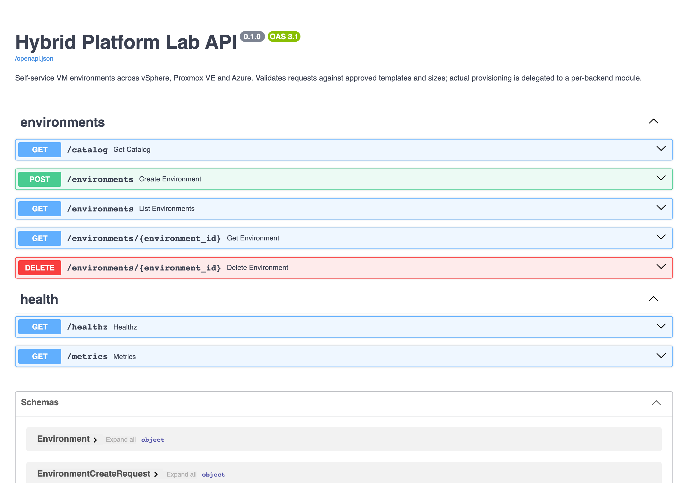
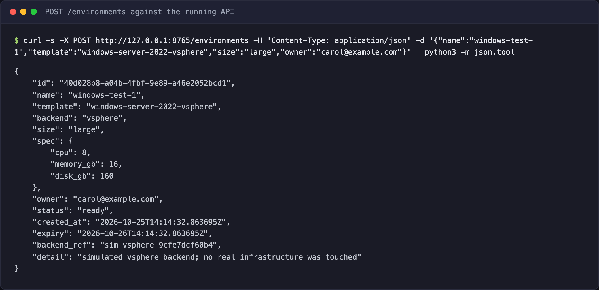
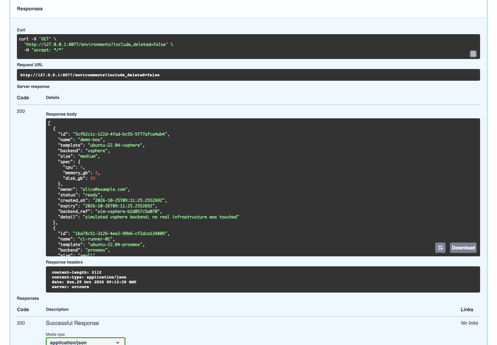
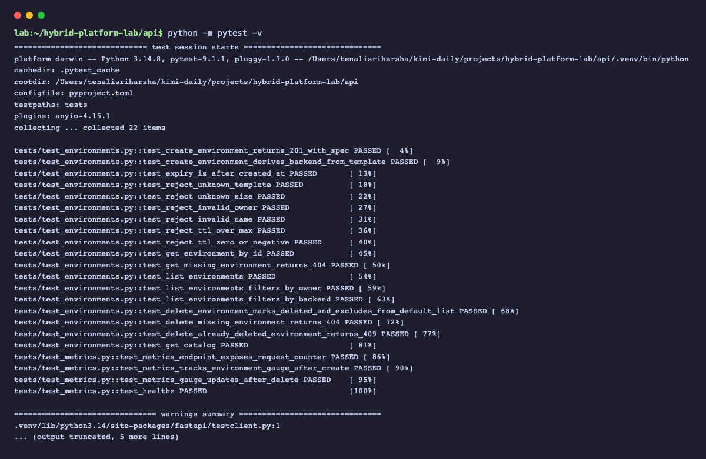
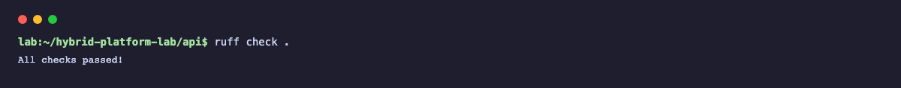
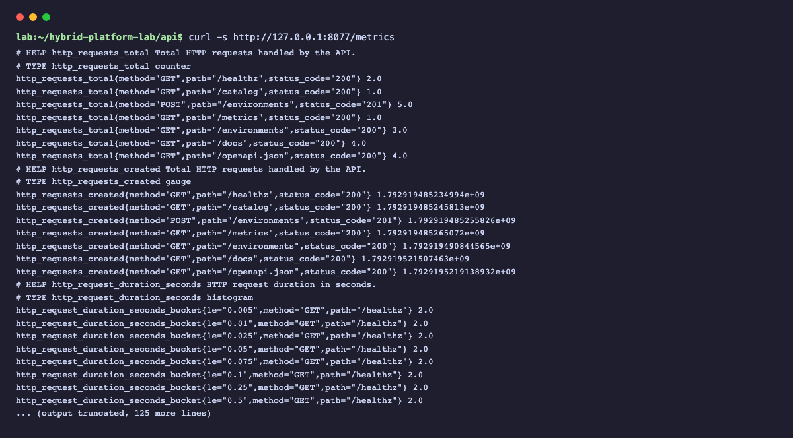
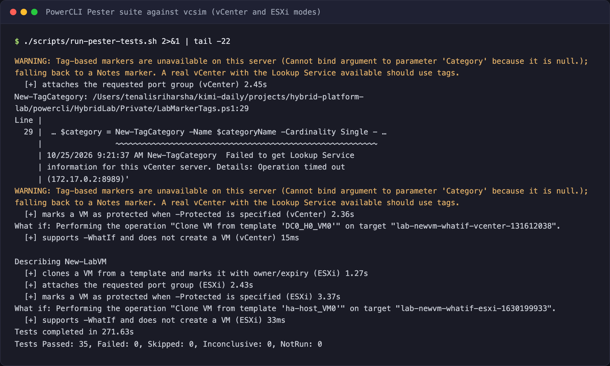
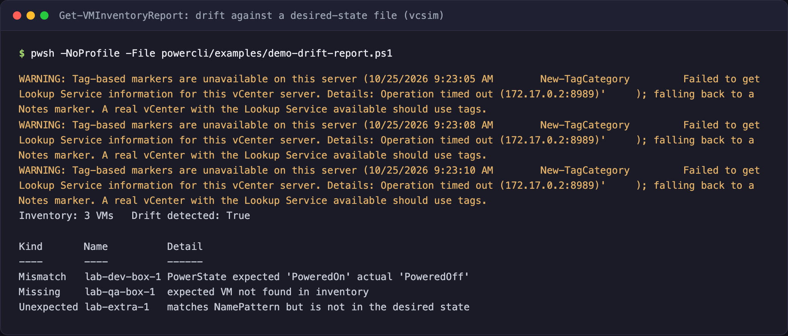
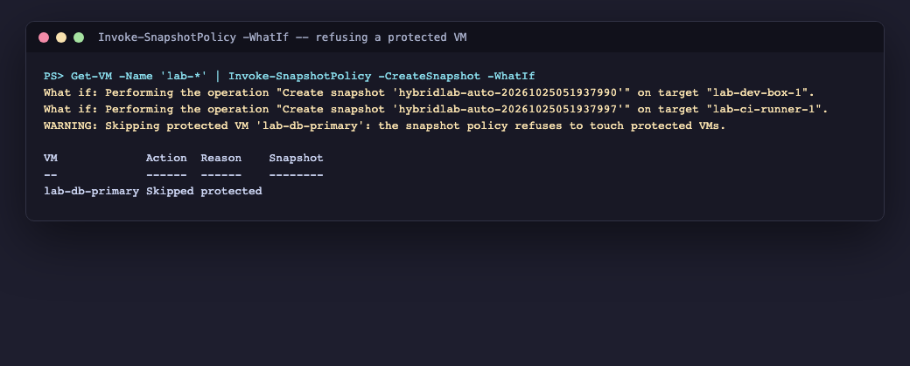

# Hybrid Platform Lab

[](https://github.com/tenalisriharsha/hybrid-platform-lab/actions/workflows/ci.yml)

A self-service VM platform spanning VMware vSphere, Proxmox VE and Azure. One
REST API validates every request against an approved catalog of templates and
sizes, then hands provisioning off to a backend module per platform: a
PowerCLI module for vSphere (the `New-LabVM` / `Get-VMInventoryReport` /
`Invoke-SnapshotPolicy` cmdlets, driven through `pwsh`), and Terraform for
Proxmox and Azure. Once a VM exists, an Ansible role and a PowerShell module
apply the same configuration baseline to it (Linux or Windows Server
respectively) so every environment starts from the same known state.

**Nothing in this repository touches a real vSphere, Proxmox or Azure
environment.** vSphere automation is exercised against [vcsim](https://github.com/vmware/govmomi/tree/main/vcsim),
VMware's vCenter/ESXi simulator; Terraform is exercised with `terraform plan`
and `terraform test` against mocked providers; nothing is ever applied. This
is a lab for building and testing the automation safely, not a production
provisioning system.

## Why

Teams running a mixed VMware/Proxmox/Azure estate end up with three
different ways to request a VM: a ticket, a hallway conversation, or direct
console access. Hybrid Platform Lab gives them one: a single API with an
approved catalog, owner and expiry tracking, and Prometheus metrics, backed
by infrastructure-as-code instead of manual clicks.

## Quick start

Requires Python 3.12+.

```bash
cd api
python -m venv .venv && source .venv/bin/activate
pip install -r requirements.txt

uvicorn app.main:app --reload
```

Then open `http://127.0.0.1:8000/docs` for the interactive API, or:

```bash
curl -s -X POST http://127.0.0.1:8000/environments \
  -H 'Content-Type: application/json' \
  -d '{"name":"dev-box-1","template":"ubuntu-22.04-vsphere","size":"small","owner":"alice@example.com"}'

curl -s http://127.0.0.1:8000/environments
curl -s http://127.0.0.1:8000/metrics
```

Run the API tests:

```bash
cd api
python -m pytest -v
ruff check .
```

The PowerCLI module (`powercli/HybridLab`) is tested with Pester against
[vcsim](https://github.com/vmware/govmomi/tree/main/vcsim), VMware's
vCenter/ESXi simulator. Requires `pwsh` and Docker:

```bash
./scripts/run-pester-tests.sh
```

This starts a vcsim container in vCenter mode and one in standalone-ESXi
mode, runs every `New-LabVM` / `Get-VMInventoryReport` / `Invoke-SnapshotPolicy`
test against both, and tears the containers down afterwards.

The Ansible `linux-baseline` role (`ansible/roles/linux-baseline`) is tested
against a real, disposable Docker container. Requires Docker, `ansible-lint`
and `ansible-playbook`:

```bash
./scripts/run-ansible-tests.sh
```

This lints the role, applies it twice to a throwaway container, asserts the
second apply is a no-op (idempotence), and tears the container down.

The `WindowsBaseline` PowerShell module (`windows/WindowsBaseline`) is unit
tested with every Windows-only cmdlet mocked, so it runs here too:

```bash
pwsh -Command "Invoke-Pester -Path ./windows/Tests"
```

## Preview

The interactive API docs (Swagger UI), a real create/list round trip against
the running API, the test suite passing, lint passing, the live Prometheus
metrics endpoint, the PowerCLI test suite running against vcsim, a real
drift report, and the snapshot policy refusing a protected VM:

| | |
|---|---|
|  |  |
| Swagger UI: every route the API exposes | `POST /environments` executed live against the running API |
|  |  |
| `GET /environments` returning real, seeded environments | The full pytest suite passing |
|  |  |
| `ruff check .` with zero findings | `/metrics` serving live Prometheus counters and histograms |
|  |  |
| The PowerCLI Pester suite - 35 tests - passing against vcsim in both vCenter and ESXi modes | `Get-VMInventoryReport` catching a missing VM, a power-state mismatch and an unexpected VM |
|  | |
| `Invoke-SnapshotPolicy -WhatIf` previewing two snapshots and refusing a VM marked protected | |

## How it works

```
                 ┌─────────────────────────┐
  POST/GET/DELETE│   FastAPI (api/)        │   /metrics
  /environments   │   catalog validation    │──────────▶ Prometheus
────────────────▶│   owner + expiry        │
                  │   per-backend dispatch  │
                  └────────────┬────────────┘
                               │
            ┌──────────────────┼──────────────────┐
            ▼                  ▼                   ▼
     vSphere backend     Proxmox backend      Azure backend
     (PowerCLI via pwsh) (Terraform plan)     (Terraform plan)
     New-LabVM            bpg/proxmox          azurerm
```

Every request names a **template** (which fixes the backend and OS) and a
**size** (which fixes CPU/memory/disk) from a fixed catalog - `GET /catalog`
lists what's currently approved. Nothing outside that catalog is accepted.

### API

| Route | Description |
|---|---|
| `POST /environments` | Create an environment. Validates template, size, owner (email) and a `ttl_hours` (1-168h, default 24h); computes `expiry` server-side. |
| `GET /environments` | List environments, filterable by `owner`, `backend`, `status`; deleted environments are excluded unless `include_deleted=true`. |
| `GET /environments/{id}` | Fetch one environment. |
| `DELETE /environments/{id}` | Tear down an environment; marks it `deleted` rather than erasing the record, for audit. |
| `GET /catalog` | The approved templates and sizes. |
| `GET /metrics` | Prometheus text exposition: request counts/latency and a live environment gauge by backend and status. |
| `GET /healthz` | Liveness check. |

### Provisioning backends

The API never provisions anything itself - it derives a backend from the
template and delegates to it:

- **vSphere** - shells out to `pwsh` and calls the `HybridLab` PowerCLI
  module's `New-LabVM` (create) and `Remove-VM` (delete). Active once
  `HYBRID_LAB_VSPHERE_SERVER`/`_USER`/`_PASSWORD` are set in the API's
  environment; falls back to a simulated backend otherwise, so the API stays
  usable without a real vCenter (or vcsim) on hand. See
  [`powercli/README.md`](powercli/README.md) for the module itself.
- **Proxmox** and **Azure** - renders a `tfvars` file from the request and
  runs `terraform plan` against `terraform/environments/dev/{proxmox,azure}`
  - **never `terraform apply`**. Active once the backend's required
  `HYBRID_LAB_PROXMOX_*`/`HYBRID_LAB_AZURE_*` variables are set; falls back
  to a simulated backend otherwise. See [Terraform](#terraform) below.

### The vSphere backend

```
DELETE /environments/{id}      POST /environments
          │                           │
          ▼                           ▼
 app/backends/vsphere.py  (env-configured: server/user/password, template → source-VM map)
          │
          ▼
 pwsh -File powercli/scripts/Invoke-VSphere{Provision,Deprovision}.ps1
          │
          ▼
 HybridLab module: New-LabVM clones + marks the VM, or Remove-VM deletes it
```

Owner/expiry/protected are written onto the VM itself - as vSphere tags on a
real vCenter, or as a `Notes` marker when tags aren't available (vcsim's
vCenter simulation never supports them; see `powercli/README.md`). The
password is read from `HYBRID_LAB_VSPHERE_PASSWORD` by the PowerShell script
itself, never passed as a command-line argument, so it never shows up in a
process listing.

| Environment variable | Required | Purpose |
|---|---|---|
| `HYBRID_LAB_VSPHERE_SERVER` | yes | vCenter/ESXi host or IP. Backend falls back to simulated when unset. |
| `HYBRID_LAB_VSPHERE_USER` | yes | Username for `Connect-VIServer`. |
| `HYBRID_LAB_VSPHERE_PASSWORD` | yes | Password; read by the pwsh script, never passed as a CLI argument. |
| `HYBRID_LAB_VSPHERE_PORT` | no | Default `443` (vcsim typically uses `8989`/`8990`). |
| `HYBRID_LAB_VSPHERE_PORTGROUP` | no | Default `VM Network`. |
| `HYBRID_LAB_VSPHERE_MODULE_PATH` | no | Path to the `HybridLab` module; defaults to the one in this repo. |
| `HYBRID_LAB_VSPHERE_TEMPLATE_OVERRIDES` | no | JSON map of catalog template → actual source VM name, e.g. `{"ubuntu-22.04-vsphere":"DC0_H0_VM0"}` for pointing at a vcsim fixture VM instead of `catalog.py`'s placeholder name. |

## Terraform

`terraform/modules/proxmox-vm` (clones a VM from a Proxmox template, via the
[`bpg/proxmox`](https://registry.terraform.io/providers/bpg/proxmox) provider)
and `terraform/modules/azure-vm` (a resource group + network + Linux VM, via
`azurerm`) are the two building blocks. Each has its own `terraform test`
suite under a local `tests/` folder, run with [`mock_provider`](https://developer.hashicorp.com/terraform/language/tests/mocking)
so it needs no real credentials:

```bash
cd terraform/modules/proxmox-vm   # or modules/azure-vm
terraform init
terraform fmt -check
terraform validate
terraform test
```

`terraform/environments/{dev,validation}/{proxmox,azure}` wire a module up
with provider configuration. **dev** has no gate - it's what the API's
Proxmox/Azure backends plan against. **validation** is stricter: an
`approved` variable defaults to `false`, and a `terraform plan` simply
refuses to proceed until it's explicitly set `true` - a small, enforced
example of promotion gating that a self-service request can't bypass on its
own. Both environment folders read their provider credentials entirely from
environment variables (`PROXMOX_VE_*`, `ARM_*`) - never from a tfvars file -
so nothing secret ever touches disk.

| Environment variable | Required | Purpose |
|---|---|---|
| `HYBRID_LAB_PROXMOX_ENDPOINT` | yes | Proxmox API endpoint, e.g. `https://pve.example.com:8006`. Backend falls back to simulated when unset. |
| `HYBRID_LAB_PROXMOX_API_TOKEN` | yes | API token (`user@realm!tokenid=secret`); translated to `PROXMOX_VE_API_TOKEN` for the provider, never written to a tfvars file. |
| `HYBRID_LAB_PROXMOX_NODE` | yes | Proxmox node to place the cloned VM on. |
| `HYBRID_LAB_PROXMOX_INSECURE` | no | Default `false`; set `true` to skip TLS verification (self-signed Proxmox certs). |
| `HYBRID_LAB_PROXMOX_TEMPLATE_OVERRIDES` | no | JSON map of catalog template → actual template VMID, e.g. `{"ubuntu-22.04-proxmox":1234}`. |
| `HYBRID_LAB_AZURE_SUBSCRIPTION_ID` / `_TENANT_ID` / `_CLIENT_ID` / `_CLIENT_SECRET` | yes | Service principal credentials; translated to the standard `ARM_*` names. Backend falls back to simulated when unset. |
| `HYBRID_LAB_AZURE_LOCATION` | yes | Azure region, e.g. `eastus`. |
| `HYBRID_LAB_AZURE_SSH_PUBLIC_KEY` | yes | SSH public key installed on provisioned Linux VMs. |

## Host baselines

Once a VM is up, two independent tools bring it to a known configuration
baseline - one per OS family. Neither is wired into the API; they're run
against a provisioned VM as the next step in the lifecycle.

**Linux** - `ansible/roles/linux-baseline` creates a local admin user,
installs a small package set, hardens `sshd_config` (no root login, no
password auth, idle-timeout and auth-tries limits), and installs and starts
`node_exporter` for Prometheus scraping. Tested by actually applying it
twice to a disposable Docker container and asserting the second run changes
nothing - see [`ansible/README.md`](ansible/README.md).

**Windows** - `windows/WindowsBaseline`'s `Invoke-WindowsBaseline` checks
(and, with `-Remediate`, fixes) service state/startup type, installed
Windows features, and enabled firewall profiles, with full `-WhatIf`/
`-Confirm` support. Every Windows-only cmdlet it touches is wrapped behind a
one-line private function so the orchestration logic is unit-testable with
mocks on any OS; the real cmdlet calls are proven by this repository's CI on
GitHub's `windows-latest` runner, since they can't run anywhere else here -
see [`windows/README.md`](windows/README.md).

## Project layout

```
api/                FastAPI service: catalog, models, store, backends, routers
  app/
  tests/
powercli/            HybridLab PowerCLI module (New-LabVM, Get-VMInventoryReport, Invoke-SnapshotPolicy)
  HybridLab/           module source (Public/Private cmdlets)
  scripts/             pwsh entry points the API's vSphere backend shells out to
  Tests/               Pester suite (run via scripts/run-pester-tests.sh)
terraform/
  modules/             proxmox-vm, azure-vm - reusable module building blocks, each with its own terraform test suite
  environments/        dev/ (ungated) and validation/ (approval-gated) folders wiring the modules up with providers
ansible/
  roles/linux-baseline/ users, SSH hardening, packages, node_exporter
  playbooks/            baseline.yml applies the role to the linux_hosts group
windows/
  WindowsBaseline/      Invoke-WindowsBaseline module (services, features, firewall)
  Tests/                Pester suite, every Windows-only cmdlet mocked
scripts/
  run-pester-tests.sh   starts vcsim (vCenter + ESXi modes) and runs the PowerCLI Pester suite
  run-ansible-tests.sh  lints and idempotence-checks linux-baseline against a Docker container
docs/
  screenshots/       Preview images embedded above
PROGRESS.md          Build plan and phase-by-phase history
DAILY_REPORT.md       Written once the project is complete
```

## Status

The FastAPI self-service API (catalog validation, the environments CRUD
surface, Prometheus metrics), the vSphere path (the `HybridLab` PowerCLI
module plus a real backend that drives it through `pwsh`), the Proxmox/Azure
path (the `proxmox-vm`/`azure-vm` Terraform modules plus real backends that
plan, never apply, against them), and the host baselines (the Ansible
`linux-baseline` role and the `WindowsBaseline` PowerShell module) are built
and tested. The CI pipeline and final docs are still to come. See
`PROGRESS.md` for the full phase plan and exactly what's done.

## License

[MIT](LICENSE)
