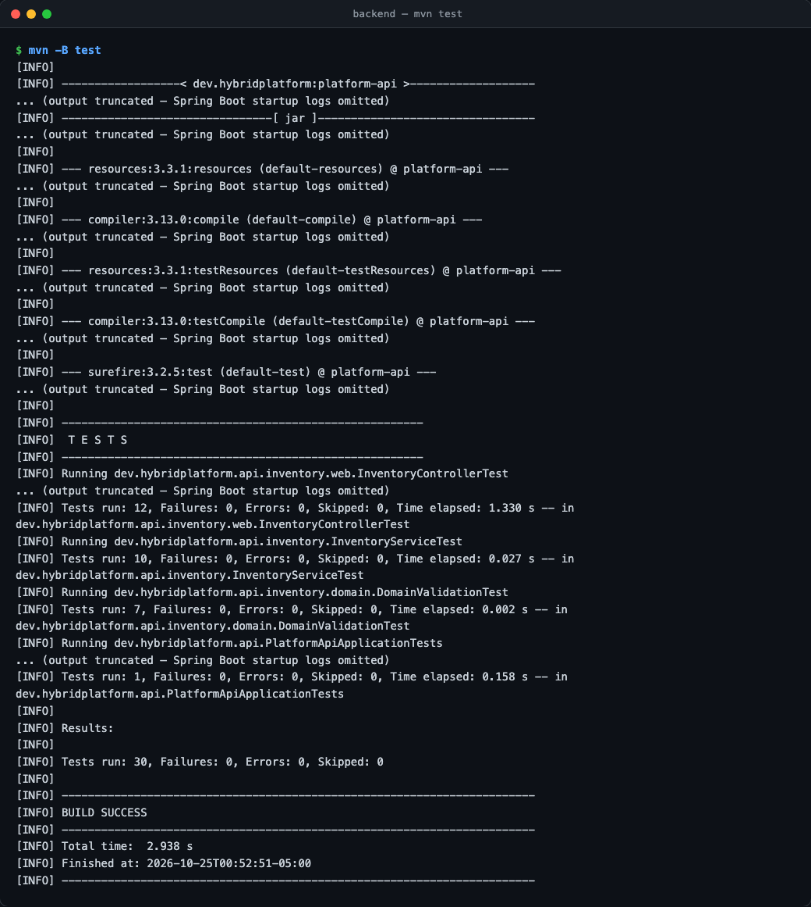
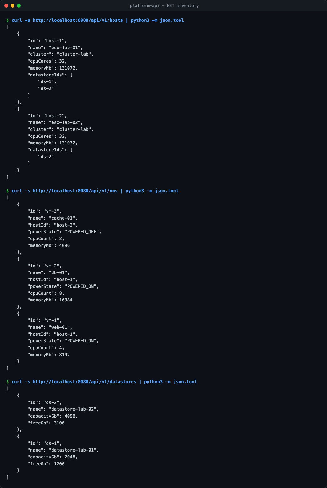
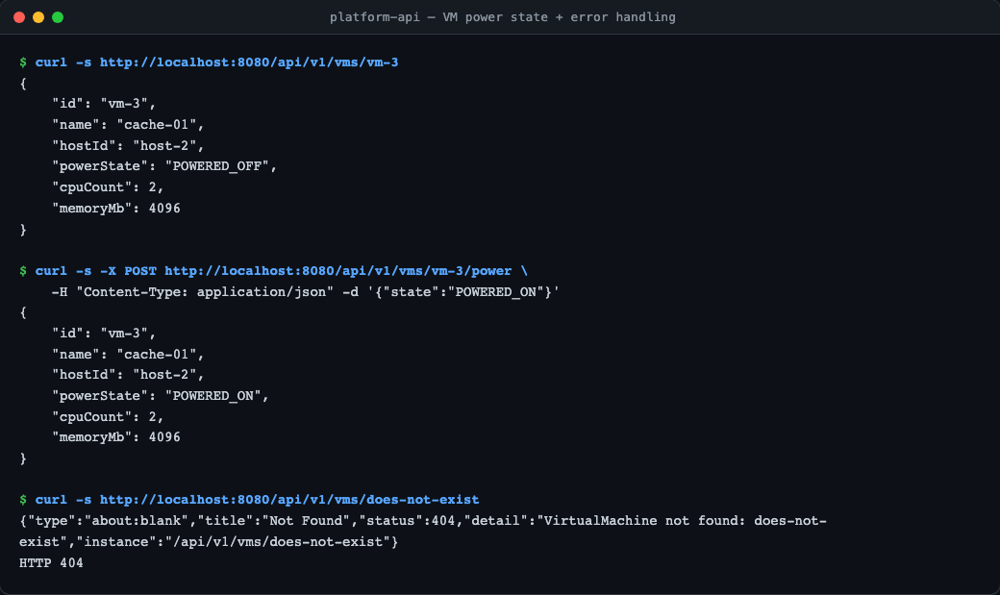
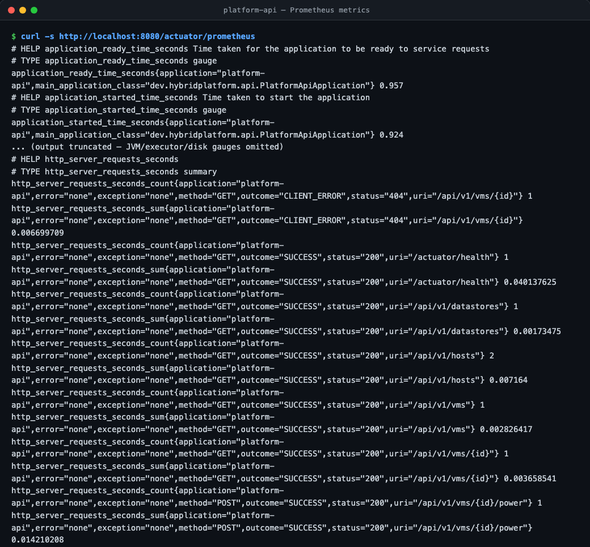
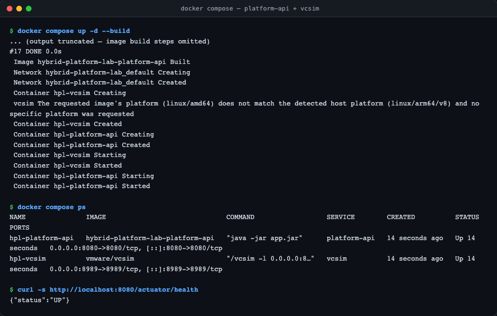
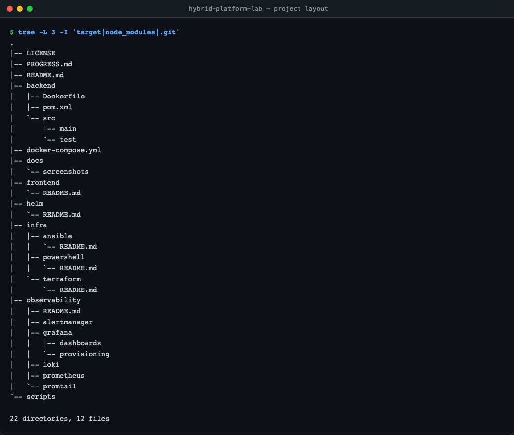
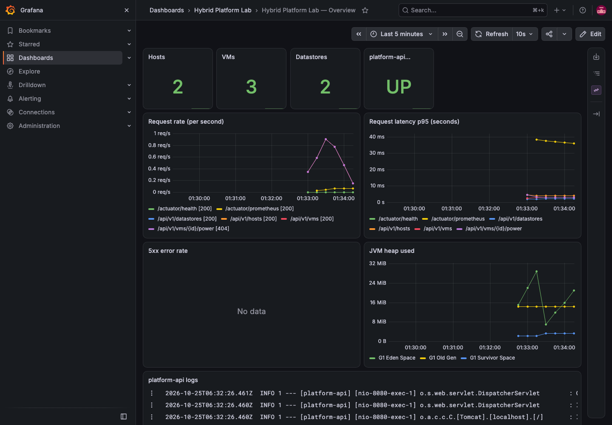
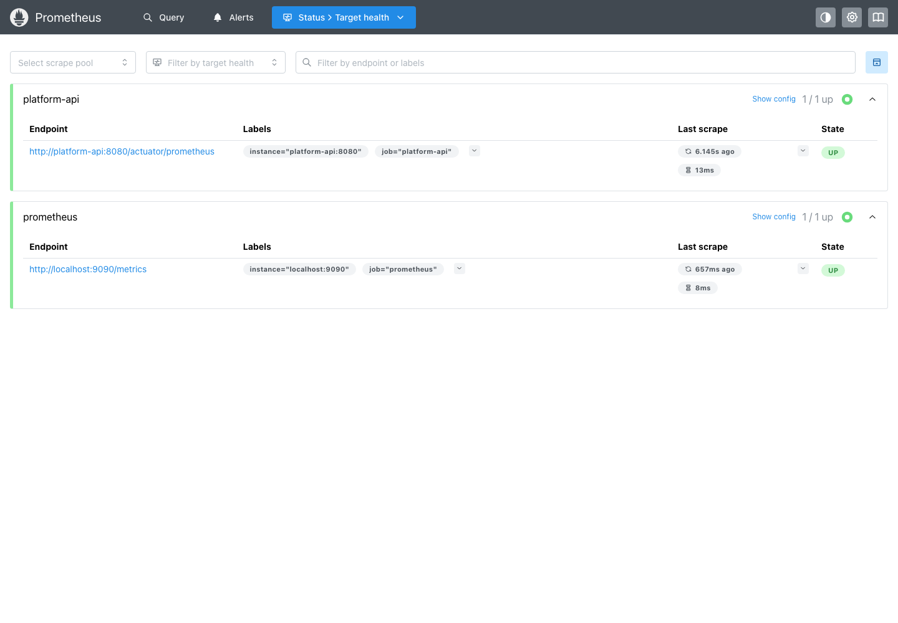
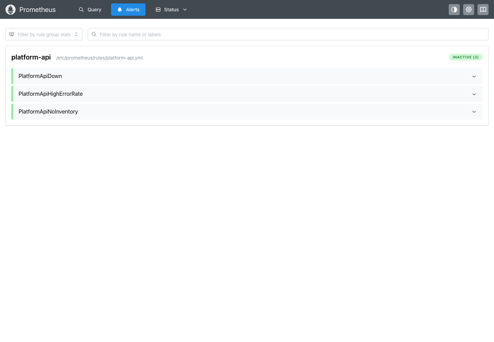
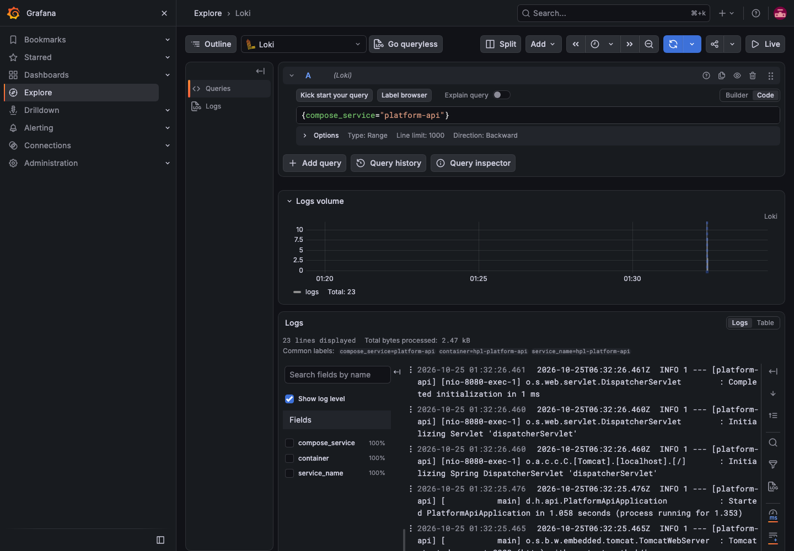

# Hybrid Platform Lab

[](https://github.com/tenalisriharsha/hybrid-platform-lab/actions/workflows/ci.yml)

A small, integrated hybrid-infrastructure control plane: a simulated
VMware estate, a Java control-plane API, infrastructure-as-code, and a
full observability stack, wired together the way a real platform team's
tooling is — not as separate, disconnected demos.

**Hybrid Platform Lab** models that intersection end to end:

- A simulated VMware estate (hosts, VMs, datastores) running on `vcsim`
- **`platform-api`** — a Java/Spring Boot control-plane service owning the
  inventory domain model, exposed over REST and Prometheus metrics
- PowerShell/PowerCLI automation syncing live inventory from `vcsim`
- Terraform + Ansible describing and configuring platform resources as code
- Prometheus, Alertmanager, Grafana, Loki, and Promtail observing the
  platform
- An Angular dashboard visualizing inventory and platform health
- A Helm chart deploying `platform-api` to Kubernetes

## Preview

**Backend test suite** — unit and integration tests covering the inventory
domain, service, and REST/Actuator endpoints.



**Inventory API** — hosts, VMs, and datastores from the simulated estate.



**VM power state and error handling** — changing a VM's power state and a
`ProblemDetail` 404 response for an unknown resource.



**Prometheus metrics** — per-endpoint request metrics exposed at
`/actuator/prometheus`, scraped by the observability stack below.



**Containerized stack** — `platform-api` running alongside the simulated
`vcsim` vCenter via `docker compose`.



**Project layout** — the full scaffold for every track of the platform.



**Grafana overview dashboard** — inventory size, request rate and p95
latency by endpoint, 5xx error rate, JVM heap, and live `platform-api` logs,
provisioned automatically (no click-ops).



**Prometheus targets** — `platform-api` being scraped live over
`/actuator/prometheus`.



**Prometheus alert rules** — `PlatformApiDown`, `PlatformApiHighErrorRate`,
and `PlatformApiNoInventory`, loaded and evaluating.



**Loki logs via Grafana Explore** — `platform-api` container logs shipped
by Promtail and queried live.



## Quick Start

Requires Java 21, Maven, and Docker.

```bash
# Run the test suite
cd backend && mvn test

# Run platform-api + the simulated vCenter (vcsim) together
docker compose up -d --build

curl http://localhost:8080/api/v1/hosts
curl http://localhost:8080/actuator/health
```

`platform-api` listens on `http://localhost:8080`:

| Endpoint | Description |
|---|---|
| `GET /api/v1/hosts` | List ESXi hosts in the simulated estate |
| `GET /api/v1/vms` | List virtual machines |
| `POST /api/v1/vms/{id}/power` | Change a VM's power state |
| `GET /api/v1/datastores` | List datastores |
| `POST /api/v1/sync` | Replace the in-memory inventory with a synced estate |
| `GET /api/v1/info` | Platform metadata |
| `GET /actuator/health` | Liveness/readiness |
| `GET /actuator/prometheus` | Prometheus-formatted metrics |

### Syncing live inventory from vcsim

The `HybridPlatformSync` PowerCLI module in `infra/powershell/` connects to
`vcsim`, pulls its hosts/VMs/datastores, and posts them to `platform-api` so
the API reflects a real (simulated) vSphere estate instead of its seeded
sample data:

```bash
# with vcsim + platform-api already running (e.g. via docker compose up -d)
pwsh -NoProfile -Command '
  Import-Module ./infra/powershell/HybridPlatformSync/HybridPlatformSync.psd1
  $cred = [pscredential]::new("user", (ConvertTo-SecureString "pass" -AsPlainText -Force))
  Sync-PlatformInventory -VcsimServer 127.0.0.1 -VcsimPort 8989 -VcsimCredential $cred -ApiBaseUrl "http://localhost:8080"
'
```

Or run the full end-to-end check (boots both containers, syncs, verifies, tears down):

```bash
./scripts/integration-test-sync.sh
```

### Infrastructure as code

`infra/terraform/modules/vsphere-estate` describes the lab's vSphere
estate — datacenter, compute cluster, ESXi hosts, and NAS datastores — as
a Terraform module validated with `terraform validate` and a
`terraform test` suite running against a fully mocked provider (no
network calls, no real credentials). `infra/ansible` renders
environment-specific configuration for `platform-api` and
`HybridPlatformSync` from one set of variables, tested with
`ansible-lint` and a real exercise of the role against `localhost`. See
each directory's README for details.

### Observability

```bash
docker compose --profile observability up -d --build
```

Starts `vcsim` + `platform-api` plus Prometheus, Alertmanager, Grafana,
Loki, and Promtail. Grafana (`http://localhost:3000`, `admin`/`admin`)
auto-provisions a Prometheus/Loki datasource pair and a dashboard showing
inventory size, request rate/latency, 5xx error rate, JVM heap, and live
logs — see [`observability/README.md`](observability/README.md) for the
full breakdown and alert rules.

## Architecture

```
                         ┌─────────────────────┐
                         │   Angular Dashboard  │
                         │   (frontend/)        │
                         └──────────┬───────────┘
                                    │ REST
                         ┌──────────▼───────────┐
                         │     platform-api      │
                         │   (backend/, Java)    │
                         │  Inventory domain:    │
                         │  Host / VM / Datastore │
                         │  REST + Actuator +    │
                         │  Micrometer metrics   │
                         └──────┬───────┬────────┘
                                │       │
     POST /api/v1/sync inventory│       │ /actuator/prometheus
                                │       │
          ┌─────────────────┐  │       │  ┌────────────────────────┐
          │ PowerShell /     │  │       │  │ Prometheus              │
          │ PowerCLI module  │  │       │  │  → Alertmanager         │
          │ (infra/powershell)│ │       │  │  → Grafana dashboards   │
          │ talks to vcsim   │◄─┘       └──│  → Loki + Promtail logs │
          └────────┬─────────┘             │ (observability/)        │
                   │ SOAP/API               └──────────────────────┘
          ┌────────▼─────────┐
          │  vcsim container  │
          │ (simulated vCenter)│
          └───────────────────┘
```

Repo layout:

```
backend/            Java 21 / Spring Boot control-plane API (platform-api)
frontend/           Angular dashboard (visualizes inventory + health)
infra/terraform/    Terraform modules describing platform resources
infra/ansible/      Ansible playbooks/roles for platform configuration
infra/powershell/   PowerCLI module syncing inventory from vcsim
observability/      Prometheus, Alertmanager, Grafana, Loki, Promtail configs
helm/               Helm chart for deploying platform-api to Kubernetes
docs/screenshots/   Preview images
scripts/            End-to-end integration test scripts
```

## Testing

```bash
cd backend && mvn test
```

37 unit and integration tests cover the inventory domain model, the
in-memory inventory service (including inventory sync and its
Micrometer inventory-size gauges), and every REST/Actuator endpoint.

```bash
pwsh -NoProfile -File infra/powershell/Run-Tests.ps1
```

Runs PSScriptAnalyzer and the Pester suite for the `HybridPlatformSync`
module (datastore/host/VM conversion, JSON export, and the sync flow).

```bash
cd infra/terraform/modules/vsphere-estate && terraform init && terraform test
cd infra/ansible && ./tests/run-tests.sh
```

Validates the Terraform module's planned topology and variable
validation rules against a mocked provider, and exercises the Ansible
`platform_config` role end to end (lint, check-mode dry run, a real run,
idempotency, variable overrides, and rejected invalid input).

```bash
./scripts/integration-test-observability.sh
```

Boots the full observability Docker Compose profile, confirms Prometheus
is actually scraping `platform-api` and has loaded its alert rules,
confirms the inventory-size gauges are queryable, and confirms Grafana's
provisioned datasources and dashboard loaded — against the real
Prometheus/Grafana HTTP APIs. Tears the stack down on exit either way.

## Status

`platform-api` (inventory domain, REST API, Actuator/Prometheus metrics,
containerized with `vcsim`), the `HybridPlatformSync` PowerCLI module
(pulling live inventory out of `vcsim` and syncing it into `platform-api`),
the Terraform/Ansible infrastructure-as-code layer, and the Prometheus /
Alertmanager / Grafana / Loki / Promtail observability stack are
implemented and tested. The Kubernetes deployment and the Angular
dashboard are in progress. See [PROGRESS.md](PROGRESS.md) for the full
phase-by-phase build plan and history.

## License

MIT — see [LICENSE](LICENSE).
